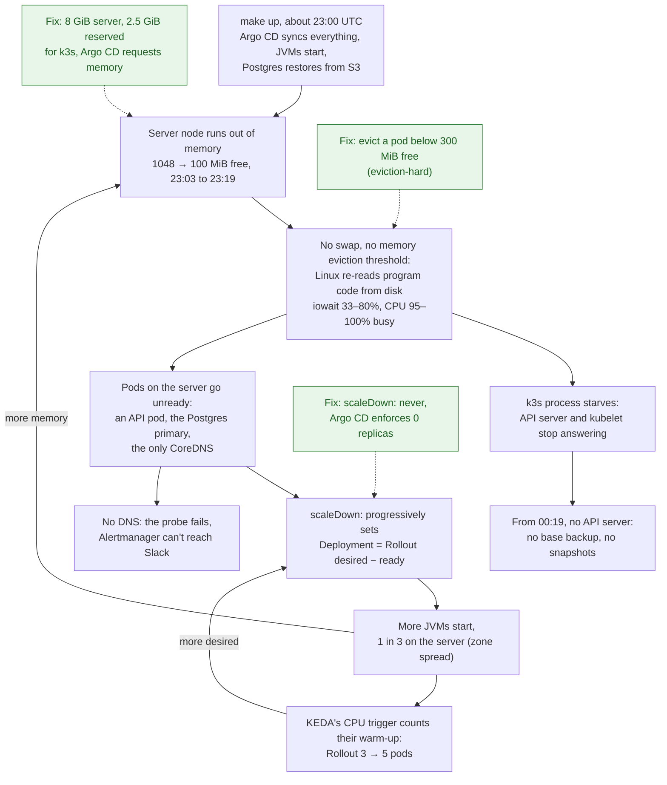

# Postmortem: k3s server ran out of memory after `make up`

| | |
|---|---|
| Date | 2026-11-06 |
| Authors | Konrad Kelly |
| Status | draft |
| Severity | page |
| SLOs affected | catalog-availability |
| Duration | 7h 40m, from the first failed request (23:21 UTC) until the nightly destroy removed the cluster (07:01 UTC on 2026-11-07). It never recovered |
| Time to detect | Under a minute: the catalog page was firing in Prometheus at 23:21, and `StorefrontProbeFailing` at 23:25. Delivery is uncertain: Alertmanager's sends to Slack were failing from 23:30 |
| Time to mitigate | Not mitigated. Nobody acted on it, and the scheduled destroy ended it |

This wasn't an experiment. It was an ordinary `make up` for the restore test, with the database recovered from S3 and
no load running. The Grafana snapshots showed the damage the next day, but the cause stayed a guess until
2026-11-08, when Grafana Cloud's copy of the metrics could be read back. The in-cluster Prometheus was gone with
the cluster.

## Summary

About 20 minutes after `make up`, the k3s server node ran out of memory. With no swap and no memory eviction
threshold, Linux kept evicting program code from memory and reading it back from disk instead of killing a process.
The k3s process, which runs both the API server and the kubelet, slowed almost to a stop. The pods on that node went
unready: an API pod, the Postgres primary and the only CoreDNS. `scaleDown: progressively` responded by starting
pods of the old Deployment, some of them on the same node. The API server answered for the last time at 00:19 UTC,
and the cluster stayed broken until the nightly destroy.

## Impact

- **Users:** none real, and no load test was running. Of the probe and background requests, 8 of 172 catalog
  requests failed with 500 overnight. From 23:27 to 23:53 no request reached the API at all, and after about 00:30
  almost none did. The synthetic probe through the Gateway failed from 23:25 until the destroy.
- **Data:** none lost. The 10 orders placed at 23:09 came back intact in the next day's restore test.
- **Error budget:** these numbers mean nothing here. The in-cluster Prometheus starts empty at every `make up`, so
  the 28-day window held about 20 minutes of traffic, and the first two failures put catalog's remaining budget at
  −4662%. The 1h burn rate peaked at 111× (01:24), on a handful of requests.
- **Missed by the SLIs:** they count requests that reach the API, and almost none did. They recorded little of a
  7.5-hour outage. The probe alert did see it.
- **Backups:** the 03:00 base backup didn't run, and the hourly Grafana snapshots stopped after 00:00. Both need the
  API server.

## Timeline (UTC)

The server node is `10.40.0.33`, and its pods have `10.42.0.x` addresses. Its 3836 MiB of memory is shared by the k3s
process, the Postgres primary `storefront-db-1`, CoreDNS, Grafana and one API pod.

| Time | Event |
|------|-------|
| 23:01 | First metrics after `make up`. Server: 1048 MiB free at 23:03 |
| 23:06 | First base backup of the restored database |
| 23:07 | The Rollout has 1 of 3 pods ready. Argo Rollouts gives the old Deployment the other 2 (`65d78976d8`), one of them on the server |
| 23:09 | Rollout at 3 of 3, so the Deployment drops back to 0. The 10 test orders go in |
| 23:17 | Server: 427 MiB free |
| 23:19 | **Trigger point.** Server: 100 MiB free, iowait 33%. The API server, `storefront-db-1` and kube-state-metrics stop answering scrapes |
| 23:21 | Server CPU 95% busy, iowait 51%. Its API pod goes unready, and the Deployment starts a pod on the server. First failed catalog requests. **Page and ticket:** `StorefrontCatalogAvailabilityBudgetBurn` |
| 23:23 | CoreDNS (one replica, on the server) stops answering scrapes, until 23:53 |
| 23:25 | **Page:** `StorefrontProbeFailing`. It stays firing until the destroy |
| 23:27 | No request reaches the API until 23:53 |
| 23:30 | Alertmanager's sends start failing (`AlertmanagerFailedToSendAlerts` fires at 23:35) |
| 00:03 | The Deployment starts another pod on the server. iowait 46–80% until 00:13. The API server answers now and then |
| 00:11 | The Rollout goes from 3 to 5 pods, and the Deployment adds 2 more. **8 API pods at 00:13**, where 3 are wanted |
| 00:14 | `NodeMemoryMajorPagesFaults` fires, the only node alert that does |
| 00:19 | The API server answers for the last time |
| 00:25 | Last sample from the server's node-exporter |
| 03:00 | Scheduled base backup doesn't run |
| 07:01 | Nightly destroy removes the cluster |

## Detection

Inside the cluster, detection worked. The catalog page fired in the same minute as the first failures, and the
probe alert four minutes later. The probe alert stayed on all night, after the request-based SLIs had gone quiet for
lack of requests.

Delivery is another matter. Alertmanager ran on an agent and stayed up, but its sends to Slack failed from 23:30.
The most likely cause is DNS: the only CoreDNS replica ran on the server. The metrics don't record whether the 23:21
page reached Slack before that. Either way, nobody acted on it. A dead man's switch outside the cluster would have
reported that the alerts had stopped arriving. That was an action item from the
[2026-10-29 control-plane stop](2026-10-29-k3s-control-plane-stop.md), and it's still open.

The node alerts didn't help. `NodeMemoryLow` and `NodeMemoryHighUtilization` went pending from 23:18 but never fired,
because the server's node-exporter kept dropping out and each gap reset their `for` timers. Only
`NodeMemoryMajorPagesFaults` fired, at 00:14, almost an hour in.

## Root cause and trigger

**Trigger:** `make up`. Within a few minutes, Argo CD syncs every app, three JVMs start, Postgres restores from S3,
and the Deployment briefly adds two JVMs of its own (23:07).

**Root cause:** the server node had no protection against running out of memory, and one setting turned the
shortage into a feedback loop.

Why it happened, step by step:

1. **Why did the API server stop?** The server node was out of memory and thrashing: iowait up to 80%, a
   major-page-faults alert, and CPU 95–100% busy with almost no useful work done.
2. **Why thrash instead of killing a process?** Without swap, the only memory Linux can reclaim is file-backed:
   program code and libraries. It evicts them, re-reads them on the next use, and the OOM killer waits while that
   still counts as progress. Normally the kubelet evicts a pod before it gets that far, but no node had a memory
   threshold. k3s's kubelet config (v1.34.12+k3s1, `pkg/daemons/agent/agent.go`) sets only
   `imagefs.available<5%` and `nodefs.available<5%`. A kubelet given any threshold
   [drops the defaults for the others](https://kubernetes.io/docs/concepts/scheduling-eviction/node-pressure-eviction/),
   including `memory.available<100Mi`. In k3s the kubelet also runs inside the starving process, next to the API
   server.
3. **Why did the node run out?** The scheduler only counts pods' memory requests. The k3s process (API server,
   controllers, scheduler, kubelet, containerd and the datastore) had no reservation, so pods could request all
   3836 MiB next to it. On 2026-11-07 the server's pods requested 2054 MiB, and their limits added up to 4074 MiB,
   more than the node has. Measured afterwards, on 2026-11-11: the k3s process alone used 1.9 GiB, and Argo CD's
   application controller used about 500 MiB on the server while requesting none, so the scheduler couldn't see
   it either. Which container grew most on 11-06 isn't known, because per-container memory isn't sent to Grafana
   Cloud.
4. **Why did it get worse instead of settling?** `scaleDown: progressively` was meant for a one-time move from a
   Deployment to a Rollout. While the Rollout's first revision is unhealthy, Argo Rollouts sets the Deployment to the
   Rollout's desired count minus its ready pods (`rollout/replicaset.go`). That covers every fresh `make up` until
   the first canary. Every pod that went unready on the server started a JVM elsewhere, and the zone spread put one
   in three of them back on the server. The Rollout's selector (`app: storefront-api`) also matches the Deployment's
   pods, so most likely KEDA's CPU trigger counted their warm-up and raised the Rollout from 3 to 5. Request rate was
   far below its trigger.
5. **Why did one node take everything down?** The server runs the control plane, the Postgres primary and the only
   CoreDNS. That's the same single point as in the [2026-10-29 control-plane stop](2026-10-29-k3s-control-plane-stop.md).

The agents were fine: their lowest free memory was about 1.4 GiB. The first guess in the ROADMAP, too many JVMs
for the two agents, was wrong.

## Resolution

There was none during the incident. The nightly destroy removed the cluster at 07:01, and the backups in S3 were
intact. The fixes in the diagram are in code and take effect on the next `make up`:

- `scaleDown: never` in [rollout.yaml](../../k8s/base/rollout.yaml). Argo CD no longer ignores the Deployment's
  replicas ([storefront.yaml](../../k8s/platform/templates/storefront.yaml)), so self-heal puts it back to 0 if
  anything changes it.
- The server is a t3.large (8 GiB), with `--kubelet-arg system-reserved=memory=2560Mi`
  ([variables.tf](../../terraform/aws/k3s/variables.tf)). That's the 1.9 GiB measured for k3s plus a third for
  load. Pods can request the rest, less the 300 MiB eviction threshold. The kubelet also caps the cgroup all pods
  share at the node's capacity less the reservation, so pods can't take the control plane's share. The agents stay
  t3.medium.
- Argo CD's pods get memory requests ([argocd-up.sh](../../scripts/argocd-up.sh)): 512 Mi for the application
  controller, and 32-128 Mi for the rest.
- On every node, `eviction-hard=memory.available<300Mi` with k3s's disk thresholds kept
  ([server.sh.tftpl](../../terraform/aws/k3s/templates/server.sh.tftpl),
  [agent.sh.tftpl](../../terraform/aws/k3s/templates/agent.sh.tftpl)). Measured at the same moment, the kubelet's
  "available" matched node-exporter's on the server and was 440-560 MiB lower on the agents. So the kubelet acts no
  later than node-exporter shows 300 MiB.

The API pods still spread over all three zones, so one runs on the server: losing any one node takes out a third of
them.

**Checked on 2026-11-11** with the first version of these fixes, which reserved 1 GiB on a 4 GiB server:
- every node had the thresholds, and the server had the reservation;
- nothing was Pending or evicted, the Deployment stayed at 0, and the Rollout used `scaleDown: never`.

But the k3s process used 1.9 GiB, and the server had 509-800 MiB free with no load, so the reservation was too
small. That led to the bigger server and the Argo CD requests above.

**Checked again on 2026-11-11, on the t3.large:**

| | 4 GiB server, 1 GiB reserved | t3.large, 2.5 GiB reserved |
|---|---|---|
| Allocatable to pods | 2512 MiB | 4960 MiB |
| Free after startup, no load | 509-800 MiB | 3712 MiB |
| k3s resident memory | 1695 MiB | 1678 MiB |
| k3s working set | 1913 MiB | 2686 MiB |

The working set grew only because a bigger node keeps more file cache. The resident memory didn't change, and the
kernel gives the cache back under pressure. Argo CD's pods had their requests, and the scheduler put the application
controller on an agent. Nothing was Pending or evicted, and one API pod ran in each zone.

**Checked during a canary on 2026-11-12.** This was the step that started the spiral on 2026-11-06. The canary went
to 20%, then 50%, and was promoted; its analysis passed. Sampled every minute on the server:

| | During the canary |
|---|---|
| Free memory | 2808-2881 MiB |
| k3s resident memory | 1776-2134 MiB (2560 MiB reserved) |
| k3s working set | 3328-3658 MiB, mostly file cache |
| Pending pods, evictions | 0, 0 |

The Deployment stayed at 0, and the server ran two API pods throughout.

## What went well

- The probe alert fired 4 minutes after the first failure and stayed on all night.
- Grafana Cloud kept the metrics after the cluster was gone. Without them this would still be a guess, and the guess
  pointed at the wrong nodes.
- No data was lost, and the restore test passed the next day.
- The agents stayed healthy, so Prometheus kept recording and sending to Grafana Cloud the whole time.

## What went poorly

- From 23:30 the alerts most likely never left the cluster, and the cluster stayed broken for 7.5 hours.
- The node memory alerts never fired: scrapes kept failing, and each gap reset their timers.
- The investigation took two days. The Grafana Cloud token could only write, and per-container memory isn't sent.
  The "130 MB of WAL" was a false lead: 18 nearly empty 16 MB segments, which Postgres forces out every 5 minutes
  (`archive_timeout`). Each compresses to almost nothing in S3.
- Error budget numbers are meaningless on a Prometheus that started 20 minutes earlier.

## Where we got lucky

- It was a lab cluster with no users, destroyed every night anyway.
- The thrashing started 10 minutes after the test orders went in. `archive_timeout` is 5 minutes, so their WAL had
  reached S3. A few minutes earlier, and the restore test would have had nothing to check.

## Action items

| Action | Type | Owner | Tracking |
|--------|------|-------|----------|
| `scaleDown: never`, and Argo CD enforces the Deployment's 0 replicas | prevent | | done, checked on 2026-11-11 |
| Reserve memory for the k3s process on the server (`system-reserved`) | prevent | | done. 1 GiB was too small (checked 2026-11-11); 2.5 GiB on a t3.large checked the same day |
| Memory eviction threshold on every node (`eviction-hard=memory.available<300Mi`) | mitigate | | done, checked on 2026-11-11 |
| Server on a t3.large (8 GiB), agents stay t3.medium. About $0.04/hr more | prevent | | done, checked on 2026-11-11 |
| Memory requests for Argo CD's pods | prevent | | done, checked on 2026-11-11 |
| Watch the server's memory during a canary | process | | done, checked on 2026-11-12 |
| Send per-pod memory to Grafana Cloud (working set summed by pod: a few dozen series), so the next incident can name the biggest consumer | detect | | |
| CoreDNS: two replicas, spread across nodes. From 2026-10-29, still open | prevent | | |
| Route `Watchdog` to an external dead man's switch. From 2026-10-29, still open | detect | | |
| Keep workloads off the k3s server. From 2026-10-29, still open. Only if the fixes above aren't enough | prevent | | |
